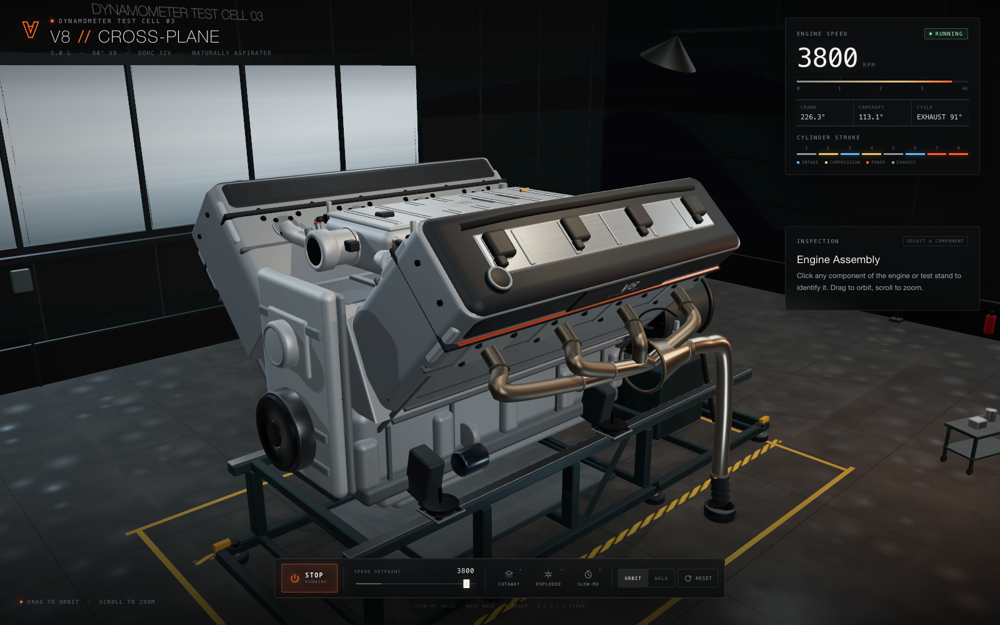
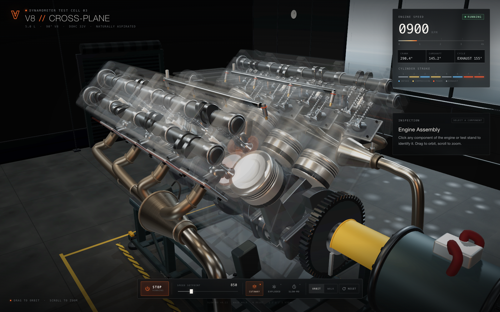
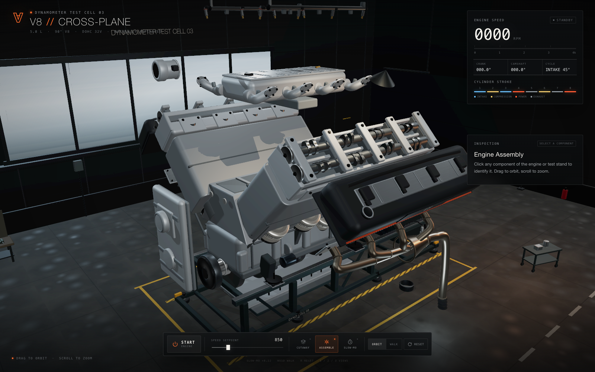
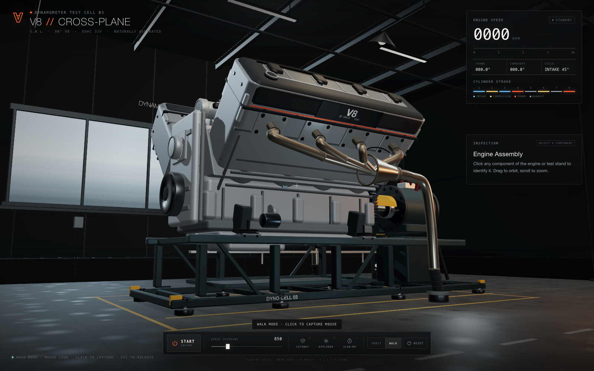
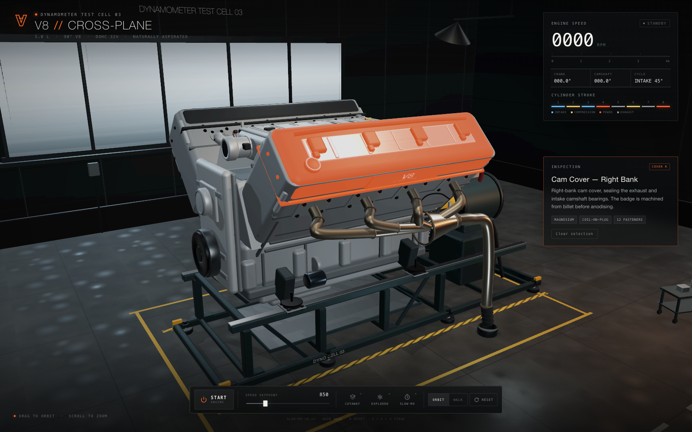

# V8 Cross-Plane — Dynamometer Test Cell

A photoreal, fully interactive 3D 90° cross-plane V8 running on a dynamometer test
stand, built entirely from procedural geometry in Three.js. Every piston, rod,
crank throw, cam lobe, valve and spring is modeled and driven by real
slider-crank kinematics — nothing is a video, a sprite, or a baked animation.



| Cutaway | Exploded |
| --- | --- |
|  |  |
| **Walk mode** | **Part inspection** |
|  |  |

## Run it

Requires **Node 18+** and a desktop browser with WebGL 2 (Chrome, Edge, Firefox
or Safari 16+).

```bash
npm install
npm run dev
```

Then open the printed URL — by default <http://localhost:5173>.

### Production build

```bash
npm run build      # writes dist/
npm run preview    # serves dist/ locally
```

`dist/` is a static bundle with relative asset URLs (`base: './'`), so it runs
unchanged from a domain root, from a subfolder, or from a GitHub Pages project
page.

### Deploy to GitHub Pages

```bash
npm run deploy     # build + force-push dist/ to the gh-pages branch
```

One-time, in the repo: **Settings → Pages → Source: Deploy from a branch →
`gh-pages` → `/ (root)` → Save.**

The site then lives at `https://<user>.github.io/<repo>/` and every later
`npm run deploy` updates it. This path needs no CI, no Actions minutes, and no
secrets — it is just a branch of static files.

`.github/workflows/deploy.yml` is there as well, for anyone who prefers CI:
set **Settings → Pages → Source: GitHub Actions** and push to `main`. It does the
same build and deploy, and cancels superseded runs. (Note that Actions requires a
GitHub account in good billing standing — a locked account fails at the job level
before any step runs. The branch route above is unaffected.)

`dist/` uses relative asset URLs (`base: './'`), so it works at a domain root, in
a subfolder, or on a project page, and `.nojekyll` is emitted so no branch
processing interferes. Every asset is procedural, so there are no CORS or CDN
surprises either way.

## What's in the scene

| System | Detail |
| --- | --- |
| Block | Deep-skirt aluminium block, 90° banks, valley casting, main-bearing bulkheads, wet liners, sump, core plugs, breather, knock sensor |
| Rotating assembly | Cross-plane crank with eight throws, counterweights, journals, connecting rods with caps and bolts, forged pistons with ring bands, damper, flywheel, dyno coupling |
| Heads | DOHC castings, cam carriers, towers and caps, 32 valves, springs, retainers, buckets, ports, spark plugs |
| Valve train | Four camshafts at exactly half crank speed, lobes phased to the firing order, 250° crank duration |
| Intake | Valley plenum, eight curved runners, port flanges, fuel rails, eight injectors, throttle body with blade |
| Exhaust | Four-into-one headers per bank, merge cones, O2 sensors, tailpipes into the floor extraction ducts |
| Test cell | Steel skid and rails, engine mounts, water brake dyno, driveshaft coupling, control cabinet, beacon, floor ducts |
| Room | Industrial cell with concrete floor, glazed wall, roof trusses, strip lighting, drums, tool trolley, workbench |

All geometry is generated at runtime from `src/engine/spec.js` — no model files
are downloaded, and there is no loading screen because there is nothing to load.

## Controls

| Action | Input |
| --- | --- |
| Orbit | Left-drag |
| Zoom | Scroll wheel / pinch |
| Pan | Right-drag |
| Walk | `WALK` button or `V`, then `WASD`, mouse to look, `Shift` to run |
| Capture mouse | Click in walk mode (pointer lock); `Esc` releases |
| Inspect a part | Click it — highlights orange and fills the inspection panel |
| Start / stop engine | `START` / `STOP`, or `Space` |
| Speed setpoint | Slider, 0–4000 rpm |
| Cutaway | `C` — ghosts the outer castings to reveal internals |
| Exploded / assemble | `X` |
| Slow motion | `M` — 0.22× time scale |
| Reset camera | `R` |
| Preset views | `1` / `2` / `3` |

## How the motion works

`src/engine/spec.js` holds one firing table. Crank angle drives everything:

- **Pistons / rods** — exact slider-crank solution
  `pinY = r·cos θ + √(L² − (r·sin θ)²)`, so the rod stays attached and the
  piston velocity is asymmetric about mid-stroke, as on a real engine.
- **Camshafts** — rotate at `θ / 2`, with each lobe's angular position derived
  from its cylinder's firing angle, so valve events line up with piston position.
- **Valves** — lift follows a 250° crank-duration profile per cylinder, with
  springs compressing as the valve opens.
- **Firing order** — 2-6-3-1-5-7-8-4, encoded in the cylinder table as per-cylinder
  TDC angles; combustion flashes appear in the cutaway view on each power stroke.
- **Vibration** — a small firing-frequency shake is applied to the engine only;
  the stand and room stay fixed, the way a dyno cell actually behaves.

## Project layout

```
src/
  main.js                 renderer, bloom composer, picking, animation loop
  styles.css              HUD, dock, inspection panel
  engine/
    spec.js               dimensions, cylinder table, kinematics, part copy
    engine.js             assembly, cutaway, explode, selection, telemetry
    parts/
      block.js            block, valley, liners, pan, timing cover, mounts
      rotating.js         crank, rods, pistons, damper, flywheel
      heads.js            heads, cams, valves, springs, cam covers
      intake.js           plenum, runners, rails, injectors, throttle
      exhaust.js          headers, collectors, O2 sensors, tailpipes
      stand.js            skid, dyno, coupling, cabinet, ducts
  camera/CameraRig.js     orbit + first-person walk, clamps, presets
  world/workshop.js       room, props, lighting rig
  lib/
    geometry.js           chamfered primitives, tubes, bolts, badges
    materials.js          PBR material library
    textures.js           procedural concrete, wall, door, noise textures
tools/shot.mjs            headless Chrome screenshot harness used for checks
shots/                    visual checkpoints
```

## Notes

- Materials are cloned per component so selection and cutaway can tint or fade
  one part without bleeding into its neighbours.
- The composer uses an 8-bit MSAA render target on purpose: half-float targets
  render black on some Metal/ANGLE drivers. Bloom + ACES tone mapping run in the
  same pass chain (`RenderPass → UnrealBloomPass → OutputPass`).
- Draw calls are high (~6k) because bolts and fins are individual meshes with
  per-part materials; it holds 60 fps on discrete or Apple-silicon GPUs and
  scales down with the browser's device pixel ratio cap (1.8×).
